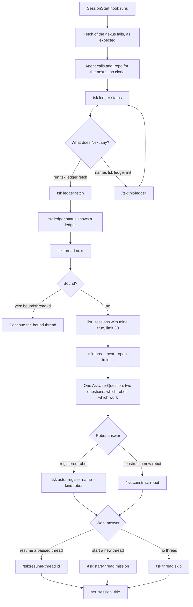
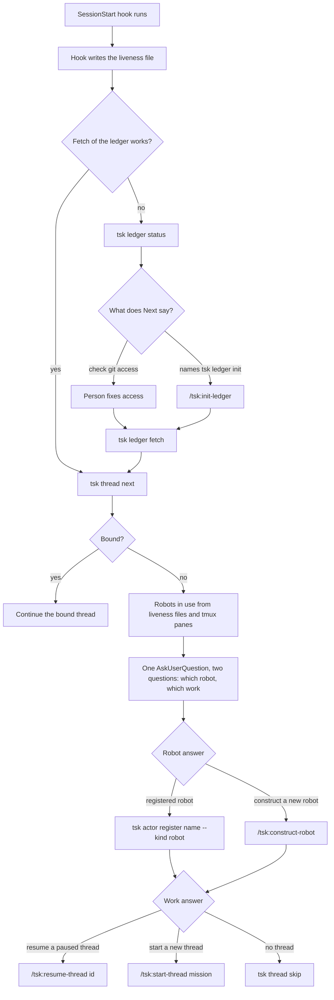
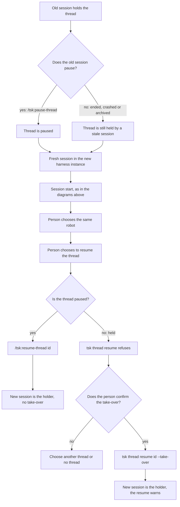
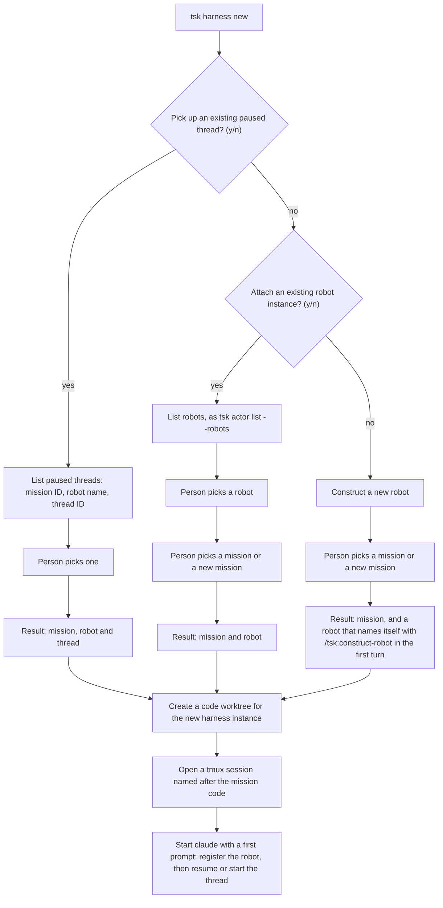
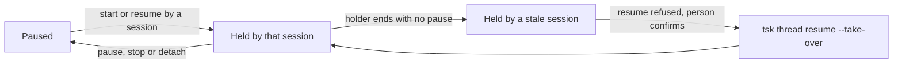

# How sessions, robots and threads start and move

Status: design, 2026-11-14. The diagrams of session start, of moving a thread and of
thread states show built behaviour (tsk 0.57.0 to 0.63.0, ADR 0030 and ADR 0032). The
diagram of `tsk harness new` is a design by Jim. The `tsk harness new` command
does not exist yet, and nothing here says when it will.

This page draws the flows in one place. The steps in words are in
[session-start.md](../user-guide/session-start.md). The rules are in
[ADR 0032](../adr/0032-a-thread-has-one-open-session-and-a-robot-works-in-many.md) and
[ADR 0030](../adr/0030-an-actor-belongs-to-a-session-and-an-instance-is-the-continuity-key.md).

## Contents

- [The terms](#the-terms)
- [A cloud session starts](#a-cloud-session-starts)
- [A terminal session starts](#a-terminal-session-starts)
- [A thread moves between harness instances](#a-thread-moves-between-harness-instances)
- [The proposed tsk harness new command](#the-proposed-tsk-harness-new-command)
- [The states of a thread](#the-states-of-a-thread)
- [Open questions for tsk harness new](#open-questions-for-tsk-harness-new)

## The terms

- A harness instance is a place where a harness runs, such as a cloud session container or a
  code worktree with its terminal.
- A session is one conversation in an instance.
- A robot is an identity. It works in many sessions at once.
- A thread has at most one open session, its holder.

## A cloud session starts

A new cloud session has one repository attached, so the fetch of the nexus at session start
fails. That is expected. The agent attaches the nexus with `add_repo`, does not clone it, and
reads `tsk ledger status` to learn the next step. One question round then gives the robot
and the work.

The title is `<mission>: <robot>`, or `NO-MISSION: <robot>` with no mission. The agent takes
the `session_...` ID from the `Session title:` line that the command prints.

## A terminal session starts

A terminal needs no `add_repo` and no `list_sessions`. The nexus is attached to the machine
once, and `git` on the machine fetches it. The robots in use come from this machine's
liveness files and its tmux panes.

A terminal session sets no title.

## A thread moves between harness instances

A thread moves from a cloud session to a terminal, or the other way, through a pause. The
pause makes the thread paused, and any robot can resume a paused thread. If the old session
ended with no pause, the thread is still held by a session that no longer runs. The resume
refuses, and the person confirms a take-over.

The liveness checks say whether a holder is stale: the `claude` process and the tmux pane in
a terminal, `list_sessions` in the cloud. tsk never archives a session for the person.

## The proposed tsk harness new command

This is a design by Jim, 2026-11-14. The command does not exist. It runs in a terminal and
asks questions. Every branch ends in the same three steps: a code worktree, a tmux session,
and `claude` with a first prompt.

The tmux session takes the mission code as its name, as tsk names other tmux sessions (see
[tmux.md](../user-guide/tmux.md)). The first prompt differs by branch. The first branch
resumes the chosen thread. The other two start a new thread on the chosen mission. The new
robot of the third branch registers itself when `/tsk:construct-robot` runs.

## The states of a thread

A thread is paused or held. Both states are read from the ledger, so a cloud session and a
terminal session read the same answer.

A thread is held when a start or a resume follows its latest pause. A stale holder keeps the
thread held until a pause, or a take-over, changes it.

## Open questions for tsk harness new

These are open. This page answers none of them.

1. Where do code worktrees live: beside the repo, or under one folder?
2. Does each worktree take its own branch, or a detached HEAD that pushes to main? Git
   refuses one branch in two worktrees, and this repo's rule is to work on main.
3. How is a worktree removed when the agent is done?
4. Does "robot busy" mean "holds a thread" and not "has an open session"? A robot that pauses
   in the cloud and resumes locally, while the cloud session stays open, needs the first
   reading.
